# Sysmon + Atomic Red Team Detection Lab (Splunk)

A small home SOC lab where I collect Windows Security and Sysmon logs in Splunk, run simulated attacker techniques with Atomic Red Team, and find them in the logs. I also fixed two log-collection problems along the way.

**Everything here is simulated activity in an isolated lab.** It is not a real attack or a real incident.

---

## Lab Architecture

```
SOC-Windows (Windows 11)
  Sysmon + Windows Security logs
        |
        v
Splunk Universal Forwarder  --(TCP 9997, host-only network)-->  SOC-Splunk (Ubuntu 24.04)
                                                                 Splunk Enterprise
                                                                 192.168.56.10
```

| VM | Role | Lab IP |
| --- | --- | --- |
| SOC-Splunk | SIEM server (Ubuntu 24.04 LTS, Splunk Enterprise) | 192.168.56.10 |
| SOC-Windows | Monitored endpoint (Windows 11) | 192.168.56.20 |

## Tools

- Oracle VirtualBox 7.2.14
- Splunk Enterprise and Splunk Universal Forwarder 10.4.2
- Sysmon v15.22 with the SwiftOnSecurity sysmon-config
- Atomic Red Team (Invoke-AtomicRedTeam)

---

## What I Built

1. Gave the Splunk server a fixed IP on a host-only network so the forwarder always reaches it.
2. Forwarded the Windows Security log to Splunk (index `main`).
3. Installed Sysmon on the Windows VM and forwarded its log to Splunk.
4. Wrote searches that pull the fields I need (program, command line, parent program, user) out of the Sysmon events.
5. Ran two Atomic Red Team tests (account discovery and local account creation) and found each one in Splunk.

### Evidence: setup

| Step | Screenshot |
| --- | --- |
| Splunk service running | 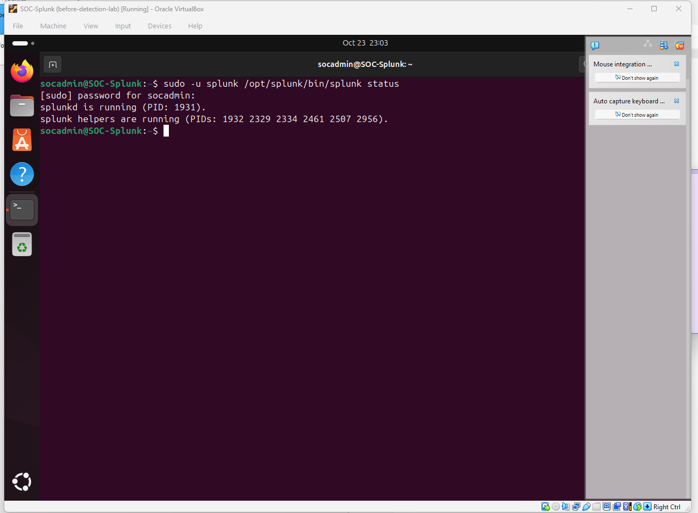 |
| Server has a fixed lab IP |  |
| Forwarder points to the server | 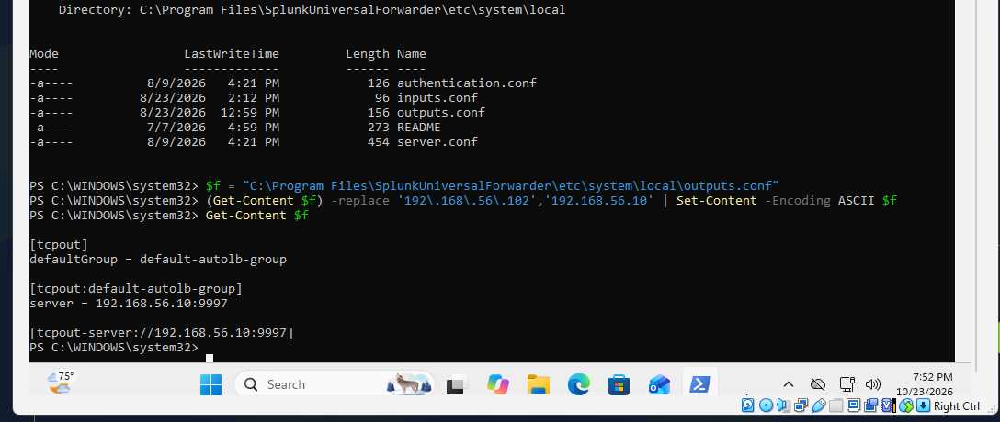 |
| Windows Security events arriving | 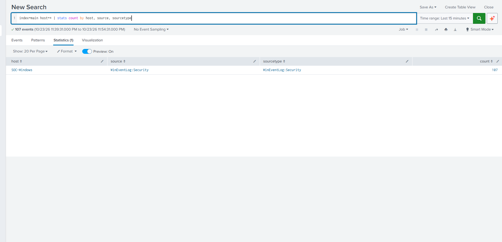 |
| Security and Sysmon logs both arriving before the second test | 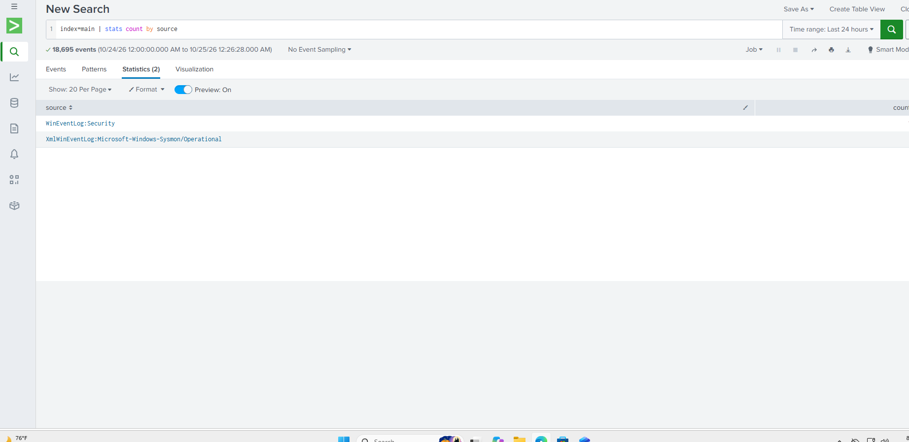 |

---

## Problems I Troubleshot

### 1. Forwarder was sending to an old IP
- **Symptom:** The Splunk server's address had been assigned by DHCP and changed, so the forwarder pointed at an address that no longer existed.
- **Fix:** Set a fixed IP (`192.168.56.10`) on the server and updated `outputs.conf` on the Windows VM to match.
- **Check:** Windows Security events appeared in Splunk.

### 2. Sysmon logs were not reaching Splunk (access denied)
- **Symptom:** Sysmon was running and writing events on the Windows VM, but nothing arrived in Splunk. The forwarder's `splunkd.log` showed `Could not subscribe to Windows Event Log channel 'Microsoft-Windows-Sysmon/Operational'` with `errorCode=5` (access denied).
- **Cause:** The forwarder's service account was not allowed to read the Sysmon log.
- **Fix:** Added the forwarder's service account to the local **Event Log Readers** group, then restarted the forwarder.
- **Check:** Sysmon events appeared in Splunk.

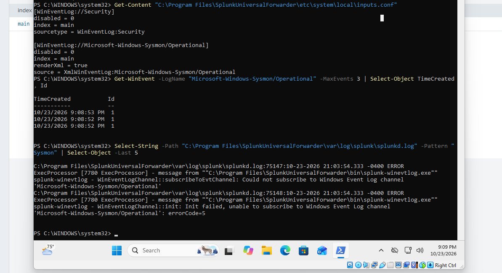

### 3. Splunk trial license expired
- The Enterprise trial had expired, so I switched the server to the Free license. This is fine for searching, but **the Free license does not support scheduled alerts**, so the detections below are manual searches, not automatic alerts.

---

## Detection: Account Discovery (MITRE ATT&CK T1087.001)

**Technique:** An attacker who has access to a machine lists local user accounts and groups to learn what is there.

**Simulation:** Atomic Red Team test `T1087.001-8` ("Enumerate all accounts on Windows (Local)"), run on SOC-Windows.

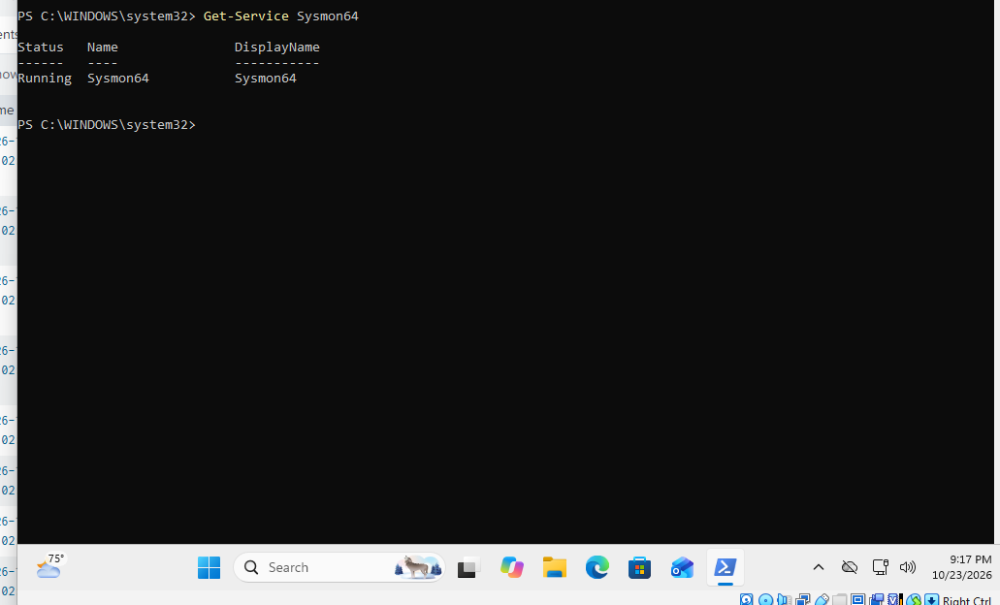


### Search

```
index=main source="XmlWinEventLog:Microsoft-Windows-Sysmon/Operational" "<EventID>1</EventID>"
| rex "Name='Image'>(?<Image>[^<]+)"
| rex "Name='CommandLine'>(?<CommandLine>[^<]+)"
| rex "Name='ParentImage'>(?<ParentImage>[^<]+)"
| rex "Name='User'>(?<User>[^<]+)"
| search Image="*\\net.exe" OR Image="*\\net1.exe" OR Image="*\\cmdkey.exe" OR Image="*\\whoami.exe"
| table _time Image CommandLine ParentImage User
| sort - _time
```

(The Sysmon fields are extracted with `rex` because I did not use the Splunk Sysmon add-on.)

### What I found

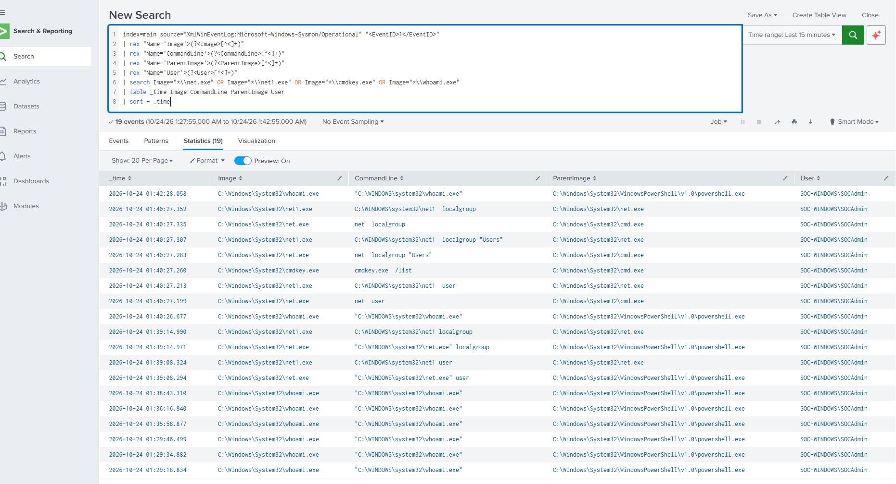

- Within about one second (01:40:26 to 01:40:27 UTC), Sysmon recorded `whoami`, `net user`, `net localgroup`, `net localgroup "Users"`, and `cmdkey /list`.
- Those commands were launched by `cmd.exe`, which is how the test script runs them.
- `cmdkey /list` checks for stored credentials, which an attacker would want to know about.
- For comparison, I also typed `net user` and `net localgroup` by hand earlier. Those ran directly from `powershell.exe`, one at a time, about a minute apart. The rapid burst and the `cmd.exe` parent are what make the test stand out.

### How an analyst would treat this
1. Look at the parent process and the speed. A fast burst of enumeration commands is unusual for a person typing.
2. Check which user ran them and whether that account normally does this.
3. Look for what happened right before and after (new logons, new services, files created).
4. Escalate if the activity is not expected or is followed by other suspicious actions.

**Possible false positives:** IT staff or management tools also run `net user` and `whoami`. The cluster and the credential check are the parts worth a closer look.

---

## Evidence: Sysmon capturing admin activity

Sysmon also recorded the permission fix from troubleshooting problem 2 (`net localgroup "Event Log Readers" ... /add`).

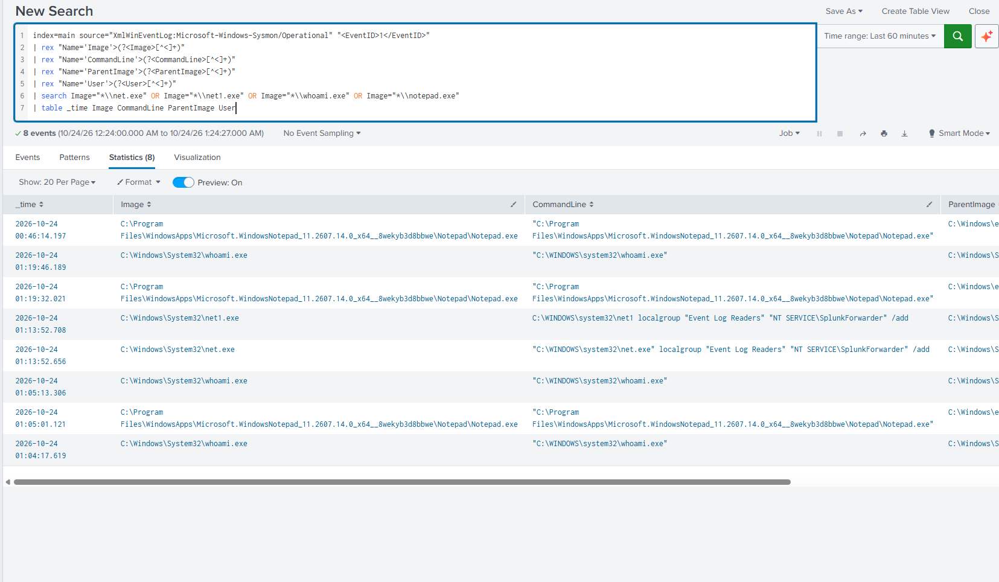

---

## Detection 2: Create Local Account (MITRE ATT&CK T1136.001)

**Technique:** An attacker who has access to a machine creates a new local account so they can get back in later.

**Simulation:** Atomic Red Team test `T1136.001-4` ("Create a new user in a command prompt"), run on SOC-Windows. It created the user `T1136.001_CMD`. I removed the account afterward with the test's cleanup command and confirmed with `net user` that it was gone.

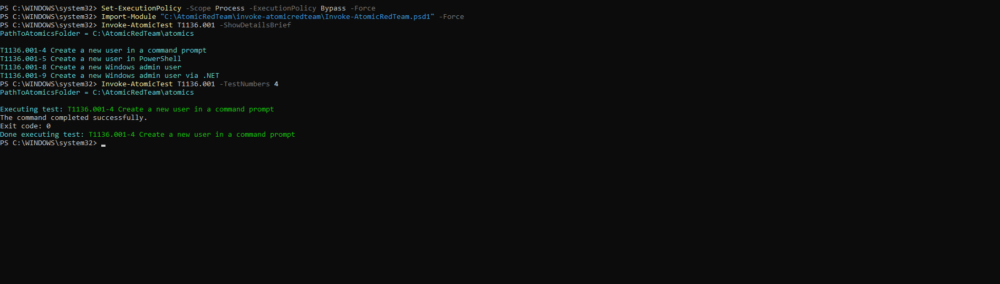

### Evidence 1: Windows Security Event 4720 (a user account was created)

```
index=main source="WinEventLog:Security" EventCode=4720
| eval creator=mvindex(Account_Name,0), new_account=mvindex(Account_Name,-1)
| table _time host creator new_account
```

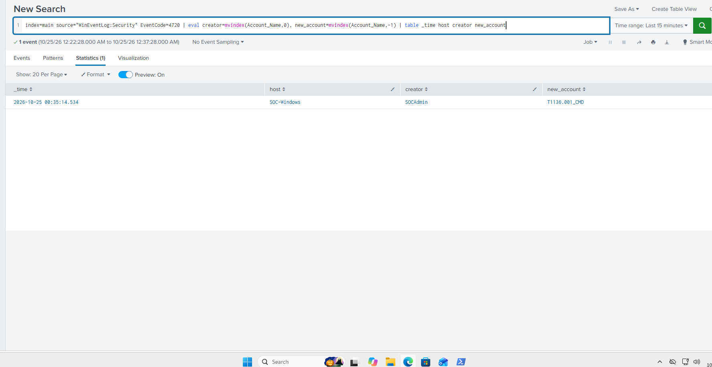

- One event on SOC-Windows (2026-10-25 00:35:14 UTC): created by `SOCAdmin`, new account `T1136.001_CMD`.
- Like Event 4625 in my other lab, Event 4720 holds two account names: the account that made the change, then the new account. I read them by position with `mvindex`.

### Evidence 2: Sysmon process creation (which command did it)

```
index=main source="XmlWinEventLog:Microsoft-Windows-Sysmon/Operational" "<EventID>1</EventID>"
| rex "Name='Image'>(?<Image>[^<]+)"
| rex "Name='CommandLine'>(?<CommandLine>[^<]+)"
| rex "Name='ParentImage'>(?<ParentImage>[^<]+)"
| rex "Name='User'>(?<User>[^<]+)"
| search CommandLine="*/add*"
| table _time Image CommandLine ParentImage User
| sort - _time
```

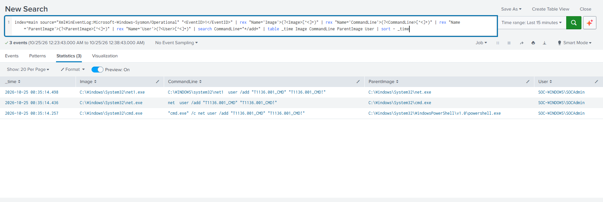

- Three events within about a quarter of a second: `powershell.exe` started `cmd.exe /c net user /add ...`, which started `net.exe`, which started `net1.exe`. All ran as `SOCAdmin`.
- The command line contains the new account's name and password in plain text, which shows why command-line logging is useful to defenders.
- The Security log shows **that** an account was created. Sysmon shows **how**: the command and the process chain. Using both gives a fuller picture.

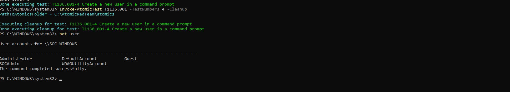

### How an analyst would treat this
1. Check whether the account creation was expected, such as a ticket for a new employee or a service account.
2. Look at who created it and from which process. Here it was `SOCAdmin` through PowerShell and `cmd.exe`.
3. Look for what the new account did next: logons (Event 4624) or being added to the Administrators group.
4. Escalate if the creation was not expected or is followed by privilege changes or logons from the new account.

**Possible false positives:** IT onboarding, imaging scripts and management tools also create local accounts. The unexpected creator, the time of day and the follow-up activity are what make it worth a closer look.

---

## MITRE ATT&CK Coverage

| Technique | Status | Evidence |
| --- | --- | --- |
| T1087.001 Account Discovery: Local Account | Done, found in Splunk | Screenshots 08 and 09 |
| T1053.005 Scheduled Task | Planned | |
| T1136.001 Create Local Account | Done, found in Splunk | Screenshots 11, 12, 13 and 14 |

---

## Limitations

- Everything is simulated on one endpoint in an isolated lab.
- Detections are manual searches, not scheduled alerts, because the Splunk Free license does not support alerting.
- The detection is based on process names and parents, so it is easy to tune but not hardened against an attacker who renames tools.
- Timestamps in Splunk are shown in UTC.

## Next Steps

- Add a detection for scheduled task creation (T1053.005).
- Add scheduled alerts once I have a license that supports them.
- Add a Kali VM so activity comes from a real separate source address.
